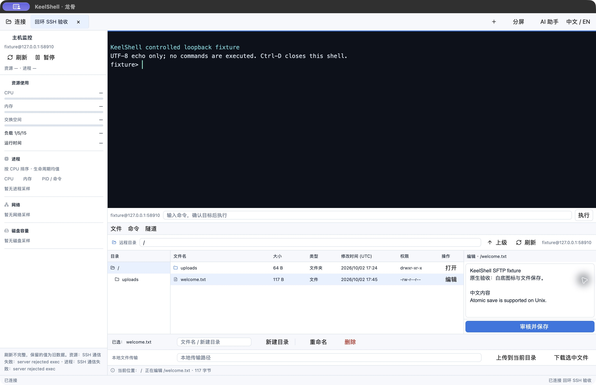
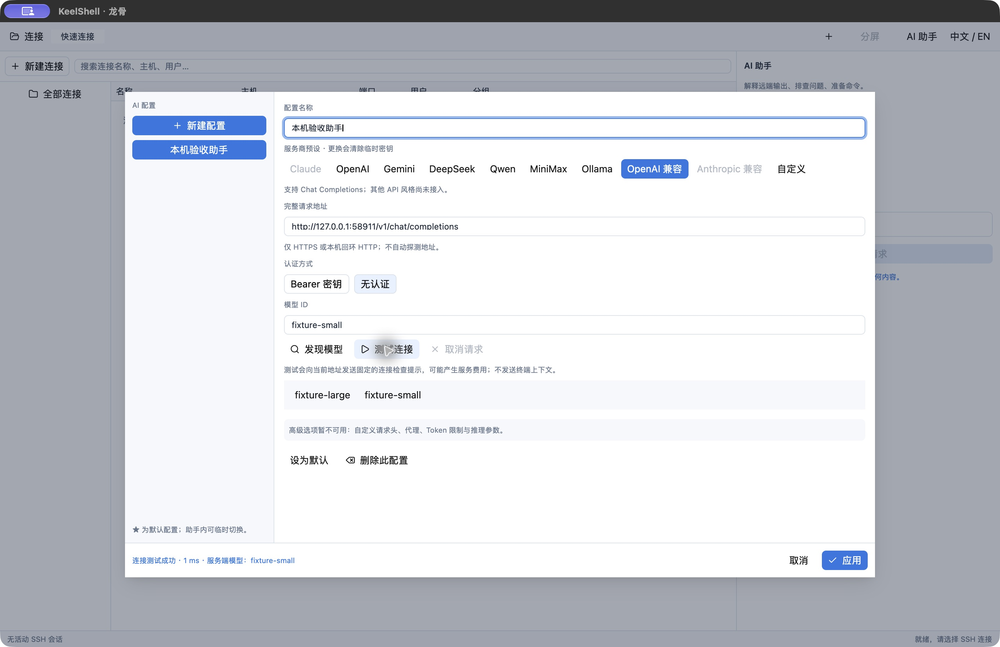

<p align="center">
  
</p>

<h1 align="center">KeelShell</h1>

<p align="center">
  <strong>连接服务器，专注眼前的工作。</strong><br>
  Rust 与 GPUI Kit 构建的原生 SSH 工作区，集远程终端、文件、主机状态和 AI 助手于一处。
</p>

<p align="center">
  简体中文 · <a href="README.en.md">English</a>
</p>

<p align="center">
  <a href="https://github.com/cyruss648/keelshell/actions/workflows/ci.yml"></a>
  <a href="https://github.com/cyruss648/keelshell/actions/workflows/release.yml"></a>
</p>

<p align="center">
  <a href="#开始使用">开始使用</a> ·
  <a href="#功能">功能</a> ·
  <a href="#ai-助手与对外-mcp">AI 与 MCP</a> ·
  <a href="docs/README.md">文档</a> ·
  <a href="docs/ROADMAP.md">路线图</a>
</p>

> **开发预览**：建议从源码运行。跨平台桌面、完整外部客户端流程及安装更新仍在验收中；功能范围以[能力清单](docs/product/CAPABILITIES.md)为准。



<p align="center"><sub>macOS 开发版本实机截图，连接自有隔离 SSH/SFTP 服务。界面随版本迭代。</sub></p>

KeelShell 面向需要连接服务器、查看日志和处理远程文件的开发者与运维人员。终端、文件和主机状态跟随当前 SSH 会话，命令与 AI 建议显示明确的工作目标。

默认简体中文，可切换英文；外观默认跟随系统，也可选择浅色或深色。应用专注远程 SSH，AI 可按需启用。

[原生工作区](docs/product/NATIVE_WORKBENCH.md)提供连接与主机信息侧栏、独立会话标签栏，以及标明当前选择的文件、命令和隧道入口。收起侧栏或切换 AI 助手会保留会话与草稿。

连接树候选补充目录折叠、方向键浏览、搜索恢复和单一 Tab 停靠点。
[限定原生记录](docs/testing/records/2026-11-05-navigation-keyboard.md)保留早期成功观察、
后期按键无响应及未成功的输入正控；完整键盘隔离仍开放。
[导航、分屏和 Ask 诊断组合](docs/testing/records/2026-11-05-workspace-integration.md)的源码提交 e331372 已通过三平台 CI，
新组合包的导航、主题、草稿及分屏限定 macOS 观察已通过非作者证据复核；
各来源包的验收范围分别保留，普通字符输入异常和完整平台矩阵仍待核实。

[文件工作区](docs/product/FILES_WORKSPACE.md)默认优先展示双栏列表，路径独占一行；纵向浏览文件行，横向查看远程列。文件操作与传输设置按需展开，批量上传/下载和队列入口保持可见，切换时保留草稿与审核规则。

[工作区布局](docs/product/WORKSPACE_LAYOUT.md)支持有界嵌套左右/上下分屏、拖动/键盘比例、逐叶标签、合并、聚焦与显式保存。修后包已取得受控 macOS 四通道、工具选择保留、两轴拖动、三个分隔条键盘及保存读回的[限定原生证据](docs/testing/records/2026-11-05-native-pane-layout.md)，并通过新的非作者组合复核与所检子集的 Hallmark finish。

单窗启动恢复已接入：恢复保存活动窗口的分屏、标签顺序和选择，显示未连接、未保存或连接缺失状态；明确点击连接后使用当前配置重新认证。启动不重放命令、传输、隧道或 AI 操作。当前专项通过，完整门禁和新包原生检查见[恢复记录](docs/testing/records/2026-11-05-workspace-startup-restore.md)。OS 外框位置、多窗口创建、紧凑 OS 窗口及完整平台矩阵仍开放；提交、推送和精确 CI 分别记录。

## 功能

| 工作流 | 能力 |
| --- | --- |
| **连接管理** | 一次性快速连接、连接目录树、标签、收藏、最近连接与回收站；批量组织、导入导出、审核式加密配置同步；密码、私钥、SSH Agent 与键盘交互认证；跳板与 SOCKS5 / HTTP CONNECT 上游代理 |
| **远程终端** | 多会话标签、分屏（嵌套布局候选验证中）、ANSI/VT 终端、滚动区搜索、选择、粘贴与中文输入；原标签手动重连及可选的有界自动重连 |
| **远程文件** | SFTP 浏览、文件和递归目录传输、暂停与内容校验续传；权限修改、文本编辑、逐项冲突选择的三方合并与严格 patch 草稿；目录比较、内容校验、双向合并及逐项审核的目录镜像 |
| **命令与任务** | 会话历史、命令片段、显式参数、远端命令与路径补全；逐目标批量命令、依赖工作流、有限定时与只读任务记录 |
| **监控与网络** | Linux 主机和逐设备磁盘 I/O 状态；监听端口、远程 DNS / TLS / HTTP(S) HEAD 诊断；显式审核的有界 [ICMP ping 候选](docs/product/ICMP_DIAGNOSTICS.md)；本地及远端 TCP 转发、回环 SOCKS5 隧道；[命名规则的审核式增改删和停止](docs/product/NAMED_TUNNEL_RULE_MANAGEMENT.md) |
| **AI 助手** | 命名模型 API / Codex CLI / Claude Code 配置；模型发现与连接测试、明确上下文、完整请求预览、回答、诊断建议及逐轮审核的有限 Agent 工作流；来源绑定的本地知识保存、搜索、审核式编辑及多选整批删除 |
| **对外 MCP** | 外部智能体读取明确授权的会话信息、终端片段、SFTP 与监控；命令和文件修改先提交提案，在桌面应用中审阅后执行 |
| **配置恢复** | 保存前轮转保留最多八份本机配置备份；恢复影响预览、明确确认、原件保留与并发变化拒绝；凭据库独立管理 |
| **主题与外观** | 霜白、曜石、雾紫三套内置主题；各自支持浅色、深色和跟随系统，选择持久化，切换保留会话及草稿；[主题指南](docs/product/THEME_PREFERENCES.md) |
| **关于与更新** | 项目主页、版本和内置变更日志；默认每日后台检查、可关闭／每周与可选 SHA-256 校验下载，确认后安装和重启 |

传输与镜像取消会保留已完成项；断线后不会自动重放命令、传输或任务。目录内容比较和同步具有明确的大小、类型及路径限制，协议诊断需要远端 POSIX / Python 3.8+。具体操作与边界见[文件工作区](docs/product/FILES_WORKSPACE.md)、[目录镜像](docs/product/DIRECTORY_MIRROR.md)、[远程协议诊断](docs/product/REMOTE_PROTOCOL_DIAGNOSTICS.md)和[能力清单](docs/product/CAPABILITIES.md)。

ICMP 候选仅接纳远端 Linux 的 iputils 20240117；工具报告的发送尝试和未获回复不能证明成功发包或纯粹网络丢包。精确生产Python命令已通过自有OpenSSH CLI的真实Linux双栈回环probe；Rust传输/解析、审核UI、外部路由及原生验收仍独立开放，见[诊断记录](docs/testing/records/2026-11-06-reviewed-diagnostics-integration.md)。

文件工作区的[多选与审核式批量传输](docs/product/FILE_BROWSER_BATCH_TRANSFERS.md)已接入选择、逐目标预览与传输队列。拖放上传已实现受控 GPUI 事件路径，原生文件管理器拖放仍有独立验收缺口；当前证据与下一步以[交接文档](docs/HANDOFF.md)为准。

[本地知识库](docs/product/AI_KNOWLEDGE_LIBRARY.md)用于整理用户明确审核的终端摘要。修改和删除先预览后确认；[多选整批删除](docs/product/KNOWLEDGE_BULK_MANAGEMENT.md)最多32条，审核包含筛选隐藏项，取消不写入，确认只保存一次。管理选择与[显式加入 Ask](docs/product/AI_KNOWLEDGE_CONTEXT.md)分别维护；发送前仍须核对历史来源和完整请求，保存开始就撤销受影响的旧审核。工程验证和新包原生验收见[本轮记录](docs/testing/records/2026-11-06-resource-knowledge-integration.md)。

[主机资源趋势](docs/product/HOST_RESOURCE_TRENDS.md)复用当前认证会话的Linux采样，显示最近五分钟、最多60点的CPU和内存历史。缺失值不作零值，暂停、错误或计数异常会断段；显示和切换主题不增加远端命令。历史仅保存在对应会话内存中，真实采样与原生平台覆盖按本轮记录分别验收。

文本合并和 patch 先生成本地草稿，远端保存需要完整审阅并重新核对基线。文件审核可以展开，确认与取消保持可见；草稿和差异输入提供明确的编辑入口。操作说明见[审核与编辑](docs/product/FILE_REVIEW_AND_FOCUS.md)和[文本合并指南](docs/product/TEXT_CONFLICT_MERGE.md)；macOS 自有 SSH/SFTP 的两次草稿与保存流程已完成完整内容读回，完整界面与跨平台验收继续进行，见[限定原生记录](docs/testing/records/2026-10-07-text-merge-patch-native.md)。

配置损坏或需要回退时，可使用[配置备份与恢复](docs/product/CONFIGURATION_RECOVERY.md)。恢复只替换配置；会话、命令、传输和外部授权不会重放。当前组合的工程与原生验收进度见[整合记录](docs/testing/records/2026-10-08-configuration-recovery-main-integration.md)。

## AI 助手与对外 MCP

**在 KeelShell 内使用 AI**：创建命名配置，选择模型 API 或本地 CLI；明确选择上下文，检查实际请求，再发送问题。API 支持 Chat Completions、Responses 和 Anthropic Messages，可配置请求头、代理、推理及采样选项。回复中的命令绑定捕获的 SSH 目标，经你审阅后再执行。

本地 Claude Code / Codex CLI 使用显式 API 凭据与受控环境；工作目录默认空隔离，也可明确选择绝对路径并审核。应用内 [Agent 工作流](docs/product/REVIEWED_AGENT.md)由 KeelShell 编排：每轮请求由你发送，每项远程命令、文件读取或已有文件替换分别审阅，结果经你确认后才准备下一轮。停止或原 SSH 会话结束会撤销旧任务；已发出的操作可能留下未知结果。供应商 CLI 自身的工具保持关闭。订阅登录、新工作流及所选目录的完整桌面与跨平台原生验收尚未完成。配置和限制见[本地智能体](docs/product/LOCAL_AGENTS.md)；API 选项见[请求配置](docs/product/AI_REQUEST_OPTIONS.md)与[推理设置](docs/product/AI_INFERENCE.md)。

**让外部智能体使用 KeelShell**：KeelShell 提供 MCP 服务端，stdio 伴随程序连接正在运行的桌面应用。你选择可访问的 SSH 会话、工具、终端片段和目录。外部智能体可以读取授权信息，或提交命令、现有 UTF-8 文件替换提案；完整目标与内容在 KeelShell 中审阅，客户端不能自行批准。配置与八项工具见[对外 MCP 指南](docs/product/EXTERNAL_MCP.md)。

这两个入口独立配置。SSH 与 AI 凭据默认临时使用，明确保存时进入主密码加密凭据库；配置导出不携带本机凭据或主机信任。详见[AI 设计计划](docs/product/DESIGN_AND_AGENT_PLAN.md)及[连接库](docs/product/CONNECTION_LIBRARY.md)。

<details>
<summary>查看 AI 配置界面</summary>



截图使用本机模拟服务，不包含真实服务凭据。

</details>

## 开始使用

安装 Rustup、Python 3.11+ 和[平台构建依赖](.github/actions/setup-build/action.yml)。项目不固定 Rust 工具链版本，请使用开发环境提供的当前支持版本；应用和 MCP 伴随程序需一起构建。

```sh
git clone https://github.com/cyruss648/keelshell.git
cd keelshell
cargo build -p keelshell-app -p keelshell-mcp --locked
cargo run -p keelshell-app --locked
```

使用 [mise](https://mise.jdx.dev/) 时，可直接运行仓库中的任务，例如 `mise run check`。

1. 在首页 **快速连接** 中填写地址、端口和用户名，开始一次性 SSH 会话；需要复用时选择 **保存为连接…**。
2. 与可信来源核对服务器指纹，完成认证后进入工作区。已保存指纹变化时，应用会阻止连接并要求重新核对。
3. 使用远程终端和文件面板。连接 Linux 主机可查看监控；需要 AI 时再配置服务与模型。

已有 OpenSSH 配置可复制后使用 **导入 SSH 配置**，审阅支持的精确 Host 与跳板条目；导入不会执行配置中的命令。

## 平台与发布

| 平台 | 构建目标 | 发布布局 |
| --- | --- | --- |
| macOS 15+ | Apple Silicon / Intel | `.app` ZIP |
| Windows | ARM64 / x64 | GUI、MCP EXE 与资源 ZIP |
| Linux | ARM64 / x64，Ubuntu 24.04 基线 | 程序与桌面资源 `.tar.gz` |

标签发布流水线配置了六个构建目标。成功的标签构建会将发布包与校验值发布到 [GitHub Releases](https://github.com/cyruss648/keelshell/releases)；实际构建、桌面和安装验收分别记录，不能由流水线配置推导为完成。

应用内 **关于/更新** 可读取变更日志、检查版本并校验下载。后台策略默认每日且下载关闭，可保存关闭／每周和可选自动下载；安装与重启需明确确认，见[更新策略](docs/product/AUTOMATIC_UPDATES.md)。平台签名、公证和安装更新验收仍开放，详见[发布说明](docs/RELEASING.md)。

## 文档与参与贡献

| 内容 | 入口 |
| --- | --- |
| 已实现能力、限制与开发计划 | [能力清单](docs/product/CAPABILITIES.md) · [路线图](docs/ROADMAP.md) |
| 操作指南与设计决策 | [文档目录](docs/README.md) · [产品设计](docs/product/PRODUCT.md) · [ADR](docs/adr/) |
| 工程结构、本地开发与检查 | [贡献指南](CONTRIBUTING.md) |
| 行为测试与平台证据 | [测试策略](docs/testing/STRATEGY.md) · [测试索引](docs/testing/README.md) |
| 本地 Ask 失败观测与已知边界 | [有界诊断设计](docs/adr/0102-local-ask-scratch-diagnostics.md) |
| CI 容量修订与验证进展 | [ADR 0103](docs/adr/0103-ci-storage-capacity.md) · [容量记录](docs/testing/records/2026-11-05-ci-storage-capacity.md) |

欢迎通过 [Issues](https://github.com/cyruss648/keelshell/issues) 报告问题、分享体验和提出建议。提供复现步骤、匿名配置和平台信息有助于定位问题；代码与文档贡献请从贡献指南开始。

KeelShell 构建于 [Rust](https://www.rust-lang.org/)、[GPUI Kit](https://gpui-kit.com/)、[Alacritty](https://github.com/alacritty/alacritty)、[russh](https://github.com/Eugeny/russh) 等项目之上。感谢这些项目及其贡献者。
