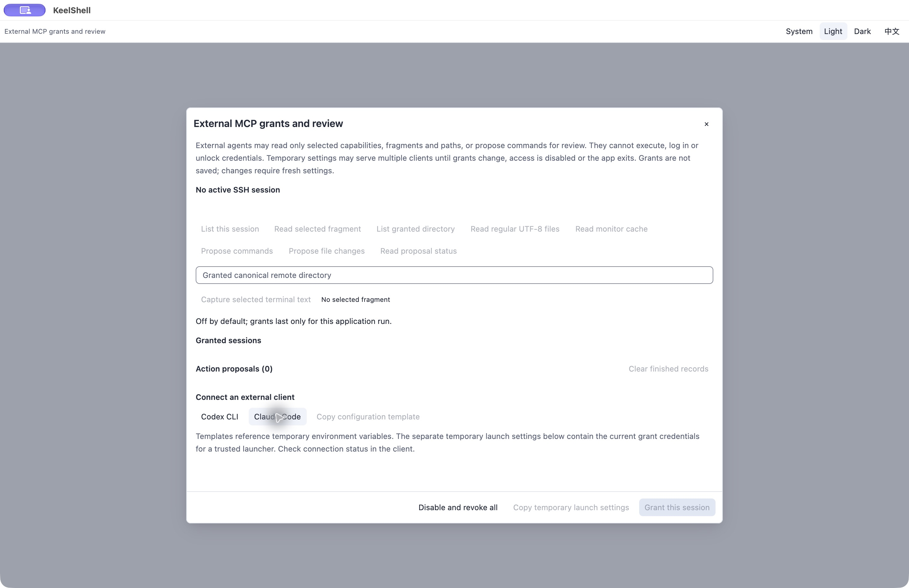
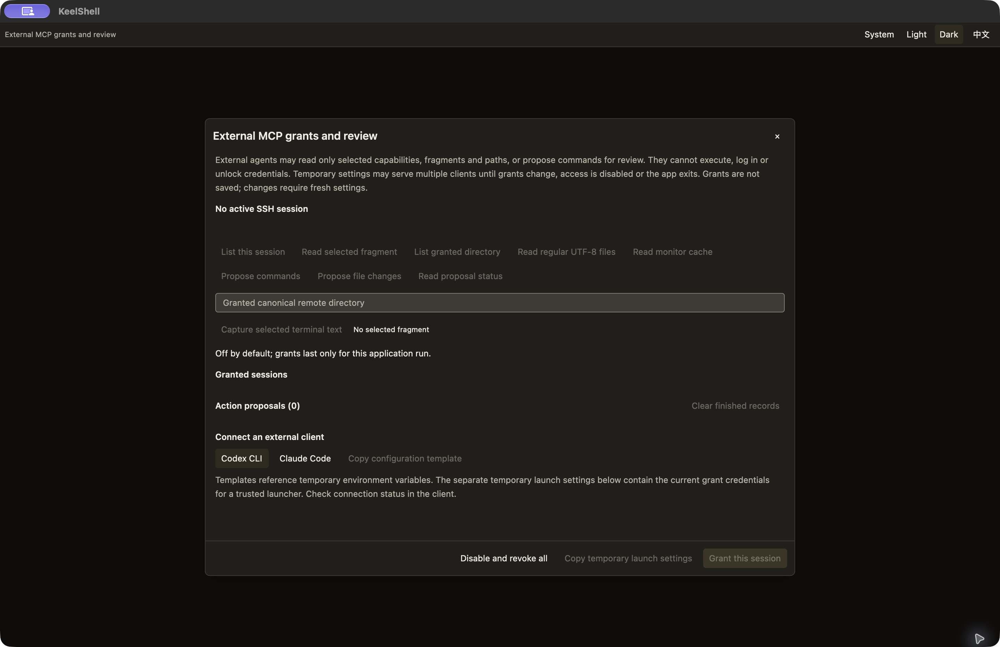
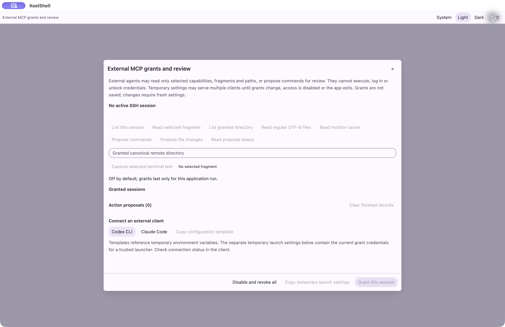

# 三推荐主题的实际 MCP 空授权面板

来源为精确工程 `f910e0013832643f09b112b08443675a956d5551` 的新正常 macOS
arm64 包，在隔离空连接库、单窗口中实际运行。三图是原 CUA JPEG 的逐字节副本，
2880×1866，没有拼图、重绘、转码或缩放；摘要见 `manifest.json`。
客户端选中项分别为 Claude/Codex/Codex，图中差别包含这一真实状态。

本次没有活动 SSH 授权，复制模板、临时启动配置、授权和清理按钮均 disabled。
原图不证明这些按钮成功执行、未知动作模态或真实供应商业务。其余 8 张原图、
全部 11 组 AX、包与实际退出回执、新非作者可见子集复核见
[本批记录](../../../testing/records/2026-11-17-mcp-client-history.md)。

霜白 / Light / English：

曜石 / Dark / English：

雾紫 / Light / English：

